Welcome here, and thank you for your support. If you have a 3D printer, you can now print a more attractive ⭐ and personalized 😎 shell for yourself! If you have enough time, you may also choose a finer print resolution.

I used PLA and PETG materials for printing. With proper printer settings, the results are fairly good with both materials.

This directory contains shell models of different versions, sorted by version number (numerical order, larger numbers indicate newer versions).

Please note that older versions will no longer be updated or modified.

> [!WARNING]
> Warning: Disassembling the shell may damage the device. You are responsible for any consequences.

> [!IMPORTANT]
> Statement: If you like the FlipperZero project and have sufficient financial ability, please purchase the original device through official channels. Building such a strong community is not easy, and we appreciate that they have open-sourced a large amount of materials. My device is not intended for counterfeiting or piracy. It includes targeted modifications and uses a completely new exterior design for clear distinction. The enclosure is fully incompatible with the original device. The purpose is to create a more affordable device and promote better development of the project.

> [!IMPORTANT]
> Additional statement: The device is intended only for legal technical learning and lawful analysis and testing by professionals (you should know what you are doing).

### Before printing your own shell, you need to know:

1. Due to cost constraints and the early stage of the project, the structure is not perfect. There are risks during disassembly and assembly. Please read the instructions carefully and make sure you have a soldering iron and steady hands.
2. Replacing and installing the shell requires hands-on ability. Make sure you can handle it before starting. Do not damage your device. You are responsible for any consequences caused by disassembly.
3. Ensure the print bed is clean and has good adhesion. When printing the front letters, the print bed quality is critical (when I first printed, I failed many times because the bed was not clean enough and adhesion was poor).
4. Choose the correct shell version. Note that each bottom shell is not compatible with others. It is recommended to use all files within the same directory and not mix different versions.
5. Be mentally prepared. Since the internal assembly is hand-soldered, there will be visible soldering marks~ (what more do you expect? :roll_eyes:~)

### How to identify the version? Observe the pattern on the bottom shell!

> [!TIP]
> If you obtained the device after February 2026, please select 3 or 4

**1. If it looks like this, it is the large RFID coil version. Please choose [1_Big_Coil](./1_Big_Coil)**
*No longer maintained*
*This directory includes 4 parts: top shell, bottom shell, buttons, and light pipe.*
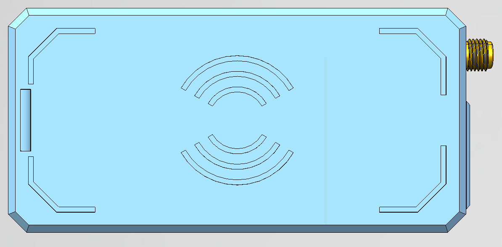

> [!TIP]
> LED_Light_Pipe.step is the front light pipe of the device and should be printed with transparent filament. If unavailable, you may leave it empty or fill it with semi-transparent glue. Alternatively, you can remove it from the existing shell and reuse it (see the end of this document).

> [!TIP]
> You will also need an infrared transparent filter. Ideally, use a dedicated infrared filter (940nm), or an easily obtainable transparent plastic sheet. The size is 18.5mm × 8mm, with a thickness of about 0.2–0.3mm. You may also reuse the one from the existing shell (see the end of this document).

**2. The large RFID coil also has a transparent version. Please choose [2_Big_Coil_Transparent](./2_Big_Coil_Transparent)**
*No longer maintained* 
*This directory includes 3 parts: top shell, bottom shell, and buttons.*
To simplify the number of parts, the transparent version optimizes the “infrared window” and “light pipe” design. No additional parts are required; the shell itself allows light transmission, making printing and assembly easier.
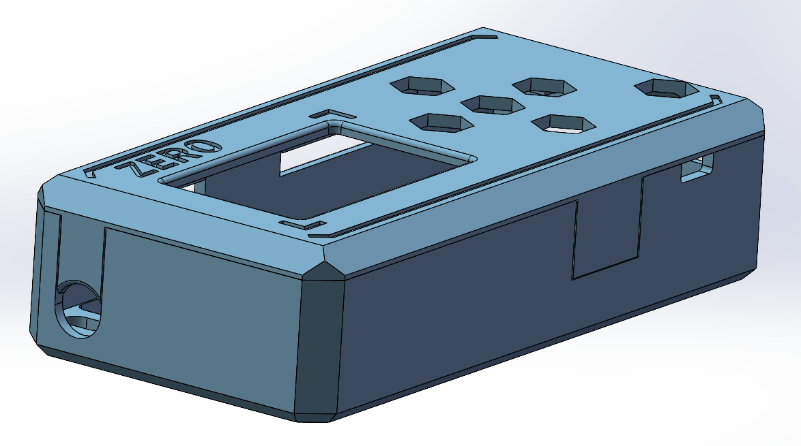
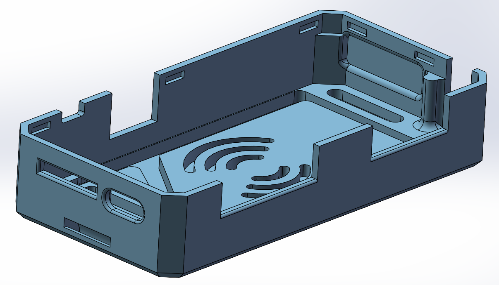

**3. If it looks like this, it is the small RFID coil version. Please choose [3_Small_Coil](./3_Small_Coil)** 
*This directory includes 4 parts: top shell, bottom shell, buttons, and light pipe.*
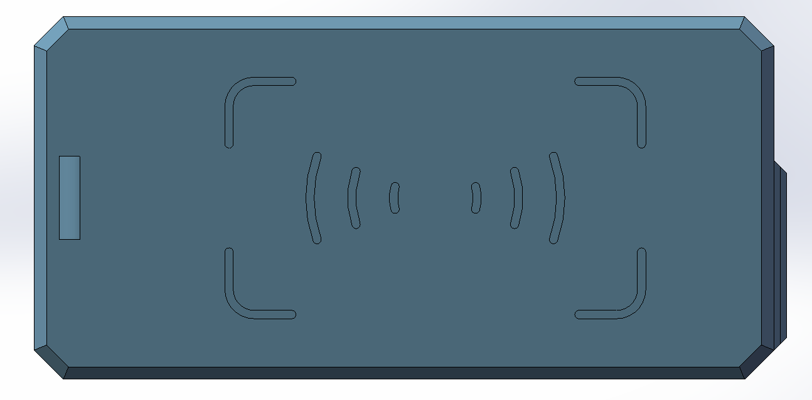
Except for modifications to the bottom shell coil, the rest is basically the same as the first version.

**4. The Exploratory transparent version for the small RFID coil, please choose [4_Small_Coli_Transparent](./4_Small_Coli_Transparent)** 
*This directory includes 3 parts: top shell, bottom shell, and buttons.*
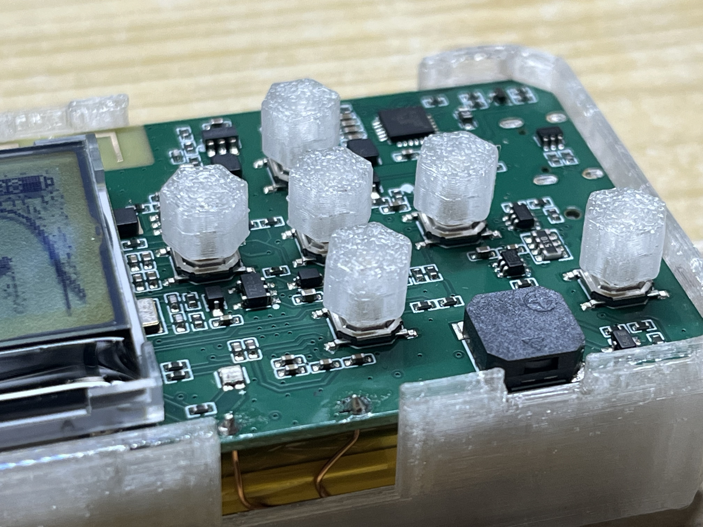
The basic version has removed the light guide pillars and side infrared windows. The keycap installation method has been changed; the keycaps can now be directly pressed onto the keys for better transparency. For ultimate transparency, you can use UV-curing printing and perform some post-processing.

Additionally, the catalog includes a "Thinner_thickness" version, which further removes the patterns on the bottom and front, and is thinner. It produces slightly better results when printed with FDM, but the shell's strength will be affected; please choose carefully.

**5. For the Internal Antenna Version, please select [5_Internal_antenna](./5_Internal_antenna)**

*This directory includes four parts: top enclosure, bottom enclosure, button, and light guide pillar.*

Although the SMA connector allows you to freely choose and match different antennas, if you prefer a more compact device, you can try this version, which hides the antenna inside the enclosure. Please note that this will reduce RF performance and shorten the communication range.

Compared with the standard version, the SMA antenna connector on the left side has been removed, and the size of the side infrared window has been slightly adjusted. Other than these changes, it is identical to the standard version.

To use an internal antenna, you will need to make some modifications to the PCB. First, purchase a 433 MHz spring antenna. The recommended size and purchase link are shown below:

[Taobao Purchase Link](https://item.taobao.com/item.htm?id=649004376195)

You may also choose an antenna according to your own needs. If you use 315 MHz more frequently, you can use a 315 MHz antenna to achieve the best performance. In addition, it is recommended to purchase an antenna with a heat-shrink protective sleeve.

Follow the **Disassembly and Assembly Instructions** to remove the PCB, then replace the original SMA antenna connector with the spring antenna shown above. Solder the antenna vertically to the back side of the PCB as shown below.

**5. For the multi-color printing version, please select [6_Colorful](./6_Colorful)**

*This directory contains 2 parts: the top housing and the bottom housing. If you also need to print the buttons or the light-guiding pillars, you can find them in the directory for the previous version.*
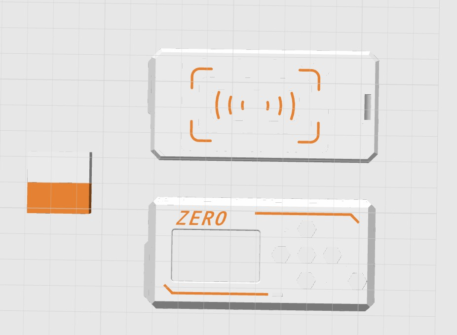
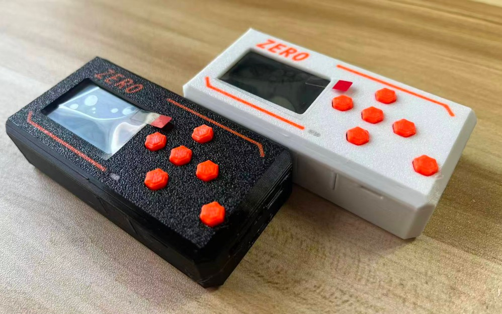

In this version, the texture depth of the model has been adjusted to facilitate coloring within your slicing software. The folder includes a sample 3MF file, which you can print as-is or modify to suit your specific printer.

### Disassembly and assembly instructions:

Although the shells and internal parts vary between versions, the disassembly and assembly steps are basically the same.

> [!TIP]
> Before disassembly, touch nearby grounded metal or use an anti-static wrist strap to avoid static damage to the circuit board.

**1. Remove the top shell**
Observe the side of the device. You will see a gap. Use a blade or your fingernail to carefully pry it open.
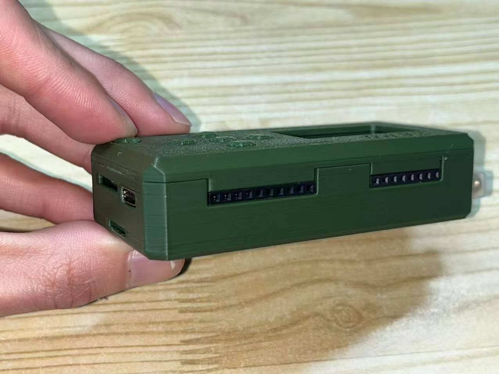
Then you will see the internal circuit board.
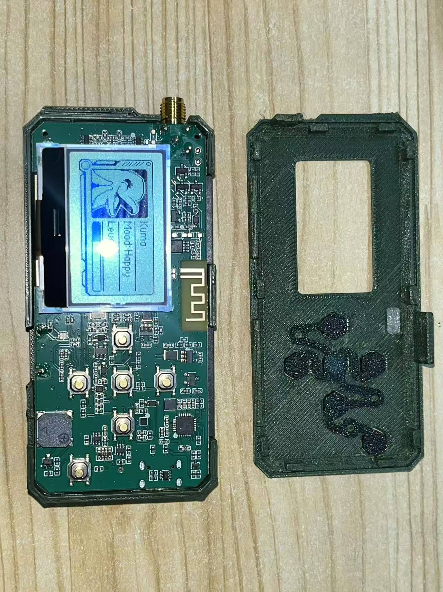

**2. Disconnect the wires**

Press and hold the back button to power off the device.
Then use a soldering iron and tweezers to remove the NFC coil. Clamp the wire with tweezers, apply downward force, and heat the solder at the same time.

> [!TIP]
> Even after powering off, many parts of the board may still carry current. Be extremely careful. Also ensure your soldering iron is properly grounded.

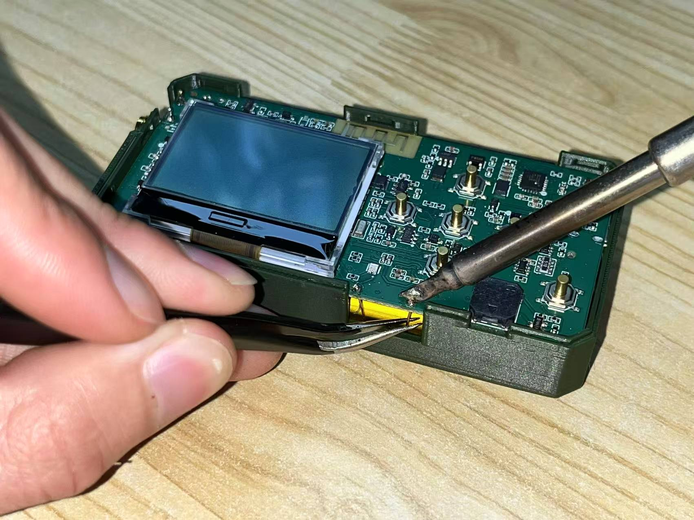

**3. Remove the main board**
Attention! There are two additional wires connected behind the main board. Remove it carefully. This is what it looks like after removal:
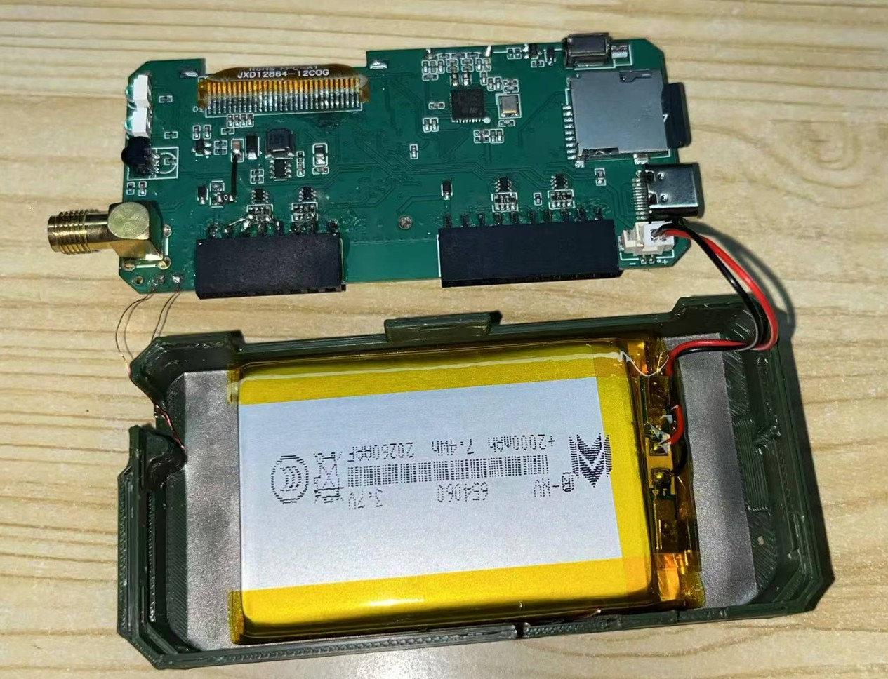
On the left is the RFID coil wire, and on the right is the battery connector. First unplug the battery connector on the right, then use a soldering iron to remove the RFID wire on the left.

**4. Remove the battery**

> [!WARNING]
> This step carries higher risk. Due to adhesive bonding, the battery may be damaged, potentially causing short circuits or other hazards. Proceed at your own risk!

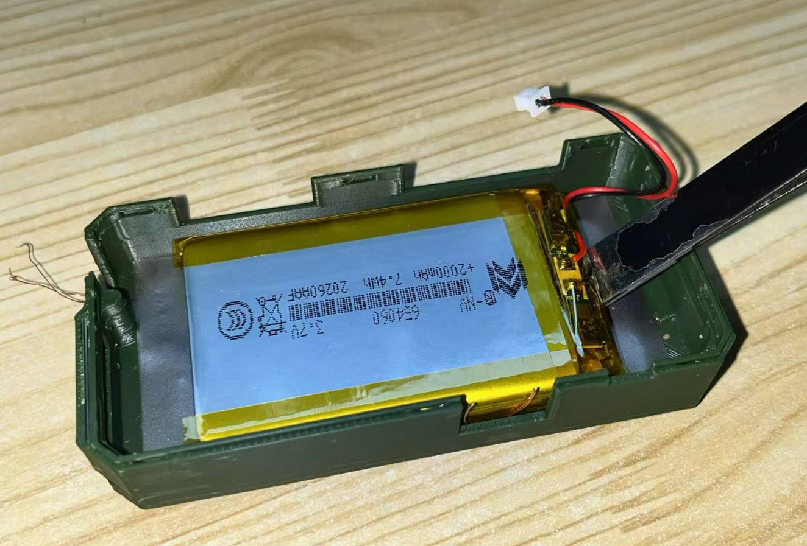
The battery is attached to the magnetic shielding sticker with 3M double-sided tape, and the shielding sticker is attached to the shell with 3M double-sided tape.
Use the back end of tweezers or a pry tool to lift the battery from the side, or use tweezers to lift a corner of the shielding sticker and try to peel it directly from the shell. If it is very difficult to remove, you can briefly place the device in a refrigerator to make the adhesive more brittle, or use a heat gun to warm the bottom of the shell to soften the adhesive.

> [!WARNING]
> If you are certain the shell will no longer be used, you may first break the shell and then carefully remove the battery from the side.

**5. Remove the coil**
If you've completed the above steps, this step simply involves removing the coil. Congratulations, you're almost done disassembling!

Now, repeat these steps in reverse order and reassemble it into the new housing.

Note that I tried various methods to secure the coil, some of which used UV-cured adhesive. While very strong and reliable😓, this method can be difficult to disassemble; you might have to break the housing to carefully pry the coil off.

>[!TIP]
>During disassembly, be careful not to scratch the insulating varnish on the coil's surface, as this could cause abnormal short circuits between coils, affecting read/write performance.

### Small parts disassembly and assembly instructions:

**Appendix 1: Light pipe removal and installation**
Use tweezers to firmly press the light pipe inward from the front.
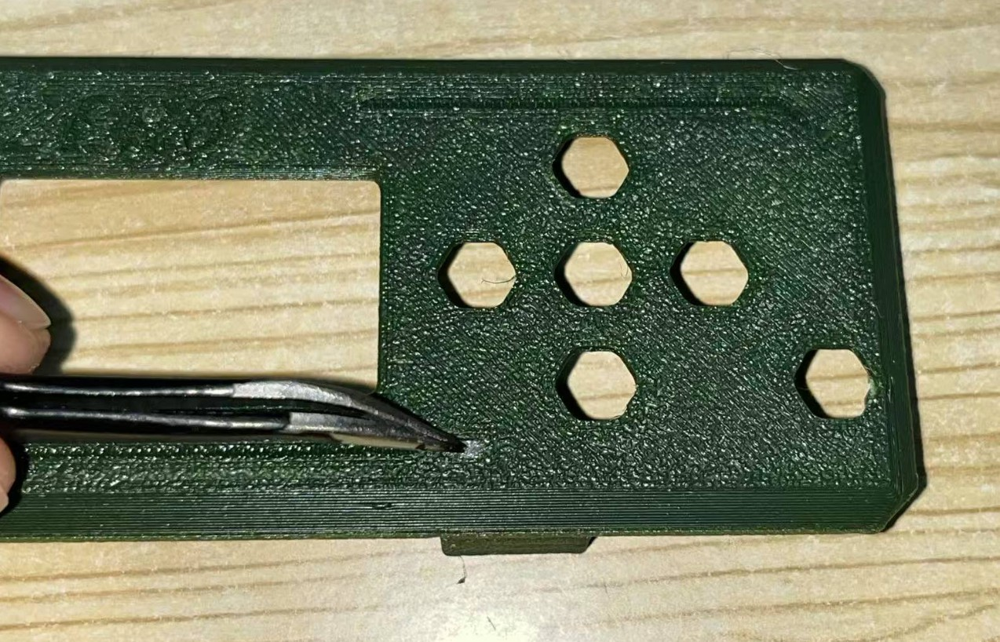

**Appendix 2: Infrared filter removal and installation**
Use tweezers to easily remove the filter. As shown in the image, it is inserted in this way and then pressed into the slot by the top shell.
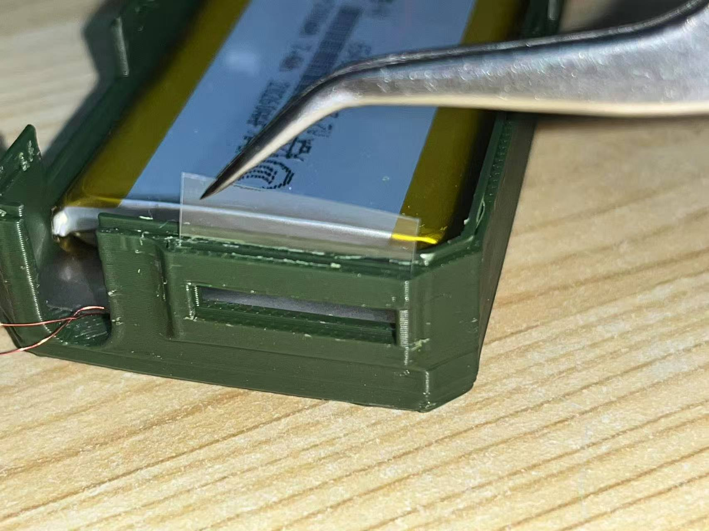
